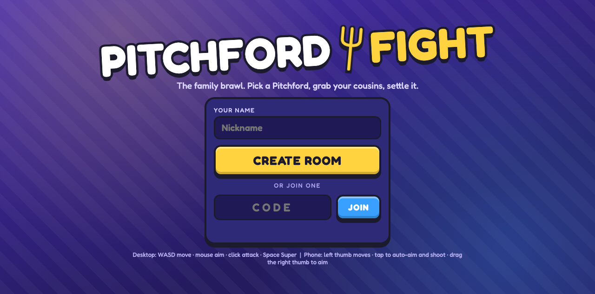
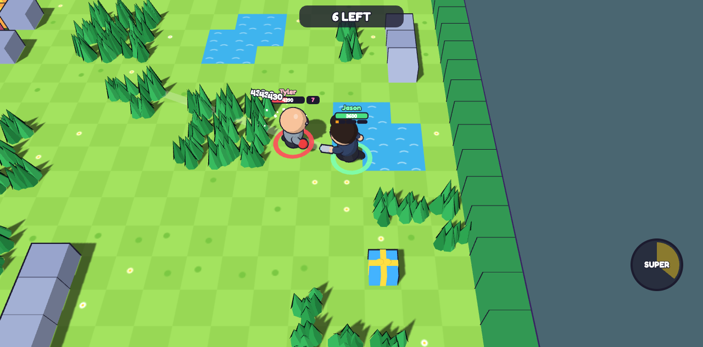
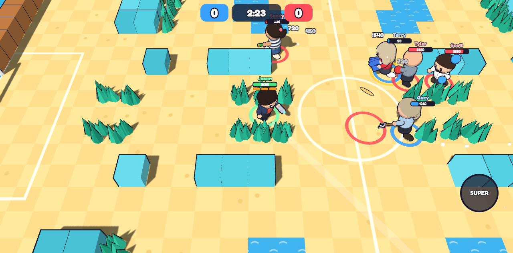
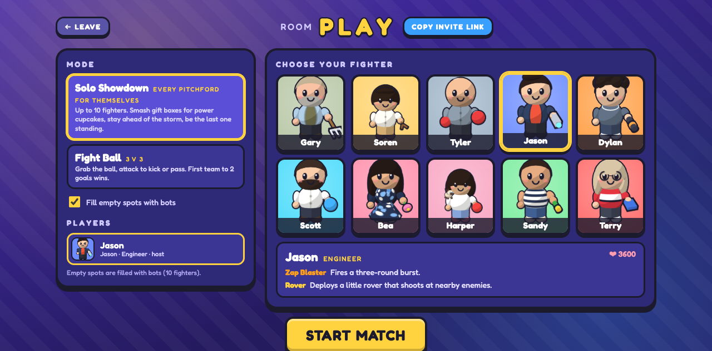

<div align="center">



# Pitchford Fight

**The family brawl.** A 3D cel-shaded, top-down arena brawler you play in the browser with a room code.
Pick a Pitchford, grab your cousins, settle it.

### [▶ Play it now — pitchford-fight.vercel.app](https://pitchford-fight.vercel.app)

No install · no accounts · desktop and phone

</div>

---

## What it is

Pitchford Fight is an original browser game built for one family's game nights. Every fighter is a cartoon version of a real family member, each with their own attack and chargeable Super. One person creates a room, shares a four-letter code, and everyone drops into the same match. Empty spots are filled with bots, so it also works solo.

| | |
|---|---|
|  |  |
| **Solo Showdown** — every Pitchford for themselves | **Fight Ball** — 3 v 3, first to two goals |

## Game modes

**Solo Showdown** · up to 10 fighters, free-for-all
Smash gift boxes for power cupcakes (more health, more damage), hide in the tall grass, and stay ahead of the storm as it closes in. Last one standing wins.

**Fight Ball** · 3 v 3
Walk into the ball to pick it up; attacking kicks it, and a Super kicks it harder. First team to 2 goals wins. If it's tied when the 2:30 clock runs out, a one-minute overtime is next-goal-wins.

## The fighters

| Fighter | Role | Health | Attack | Super |
|---|---|---:|---|---|
| **Gary** | Pitchforker | 4000 | **Fork Toss** — a pitchfork that goes straight through enemies | **Fork Storm** — pitchforks in every direction at once |
| **Soren** | Speedster | 3000 | **Slingshot** — two quick pebbles | **Sugar Rush** — zooms around and reloads fast for a few seconds |
| **Tyler** | Tank | 6000 | **Haymaker** — a big short-range punch | **Bull Rush** — charges through walls and stuns anyone in the way |
| **Jason** | Engineer | 3600 | **Zap Blaster** — a three-round burst | **Rover** — deploys a little rover that shoots nearby enemies |
| **Dylan** | Scatter | 3900 | **Scatter Shot** — a fan of five pellets | **Big Blast** — breaks walls and shoves enemies back |
| **Scott** | Lobber | 3300 | **Balloon Toss** — lobs a water balloon over walls | **Balloon Barrage** — five balloons on the target area |
| **Bea** | Sharpshooter | 2800 | **Petal Dart** — one hard-hitting long shot | **Full Bloom** — three piercing petals |
| **Harper** | Cat Wrangler | 3100 | **Yarn Ball** — bounces off walls | **Go Kitty!** — sends the cat to chase enemies down |
| **Sandy** | Support | 4200 | **Splash Wave** — a wide wave that passes through enemies | **Sunny Spot** — a zone that heals you and your team |
| **Terry** | Professor | 3700 | **Pop Quiz** — three books in a spread | **Lecture** — a shockwave that stuns everyone nearby |

<div align="center"></div>

## Controls

| | Desktop | Phone / tablet |
|---|---|---|
| **Move** | `W` `A` `S` `D` or arrow keys | Left stick |
| **Aim** | Mouse | Drag the right stick in any direction |
| **Attack** | Click (hold to keep firing) | Release the right stick — or just **tap** to auto-aim at the nearest target |
| **Super** | `Space`, `E` or right-click | Super button |

Attacks use ammo (three bars, refilling over time). Dealing damage charges your Super. Stay out of a fight for a few seconds and you heal.

## Playing with other people

1. Open the site and hit **Create Room**.
2. Hit **Copy Invite Link** and send it, or read out the four-letter code.
3. Everyone picks a fighter. In Fight Ball, tap your team badge to switch sides.
4. The host presses **Start Match**.

Good to know:

- **The host's device runs the match.** If the host puts the tab in the background or locks their phone, the game stalls for everyone. If the host leaves, the room closes.
- Landscape is much nicer than portrait on phones.
- If a phone has graphics trouble, the game steps its graphics down automatically (and remembers that for the device). Add `?gfx=0` to the address to try full quality again.

## How it works

Plain JavaScript, no build step, about 2,000 lines.

```
index.html, style.css     Page shell: home, lobby, results screens
js/data.js                Roster, stats, mode descriptions
js/sim.js                 The authoritative game: maps, combat, bots, modes (no DOM)
js/view.js                Client-side mirror: snapshot interpolation + movement prediction (no DOM)
js/render.js              Three.js toon renderer, effects, HUD, 2D fallback
js/net.js                 Room networking over WebSockets
js/main.js                App flow, input, the frame loop
relay/                    Cloudflare Worker + Durable Object that relays room traffic
```

**Netcode.** The room creator is the host and runs the whole simulation at 60 Hz. Other players send their inputs about 30 times a second; the host sends back compact snapshots plus a list of one-off events (a shot fired, a wall broken, a knockout). Clients interpolate everyone else slightly in the past, replay projectiles locally from their spawn events, and predict their own movement so controls feel immediate.

**Relay.** Players don't connect to each other directly. Every device opens an ordinary WebSocket to a small Cloudflare Durable Object, one per room code, which forwards frames between host and players without looking inside them. That keeps it working on mobile data and strict home networks. If the host's connection blips, they have about 25 seconds to reconnect before the room closes.

**Rendering.** Three.js with toon materials, a stepped light ramp and inverted-hull ink outlines. Characters are built from primitives in code and animated procedurally (idle, run, attack, hit, stun, Super, knockout). Maps are generated fresh each match from mirrored stamps, so both sides are fair. There are four graphics levels, ending in a plain 2D drawing of the match for devices where WebGL isn't available.

**Bots.** Grid pathfinding, target selection, strafing and retreating, crate farming and storm avoidance in Showdown, and chase / support / defend roles in Fight Ball.

## Running it yourself

The game is a static site:

```bash
python3 -m http.server 8000
# open http://localhost:8000
```

Out of the box it talks to the deployed relay. To run your own:

```bash
cd relay
npx wrangler dev          # local relay on ws://127.0.0.1:8787
# then open http://localhost:8000/?relay=ws://127.0.0.1:8787
```

To deploy:

```bash
cd relay && npx wrangler deploy     # relay → Cloudflare Workers; put its wss:// URL in RELAY_URL in js/net.js
npx vercel deploy --prod            # site → Vercel (or any static host)
```

## Known rough edges

- Balance is a first pass, tuned only against bots.
- No host migration: the room lives and dies with the host.
- Only lightly tested on real phones so far.

---

<div align="center">Made for the Pitchfords. 🔱</div>
